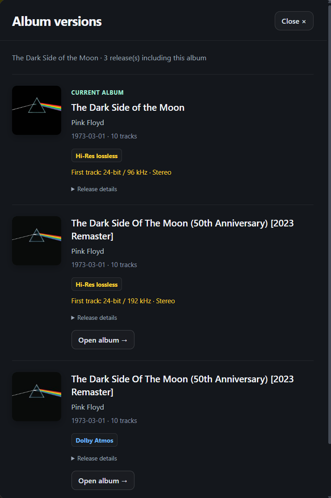
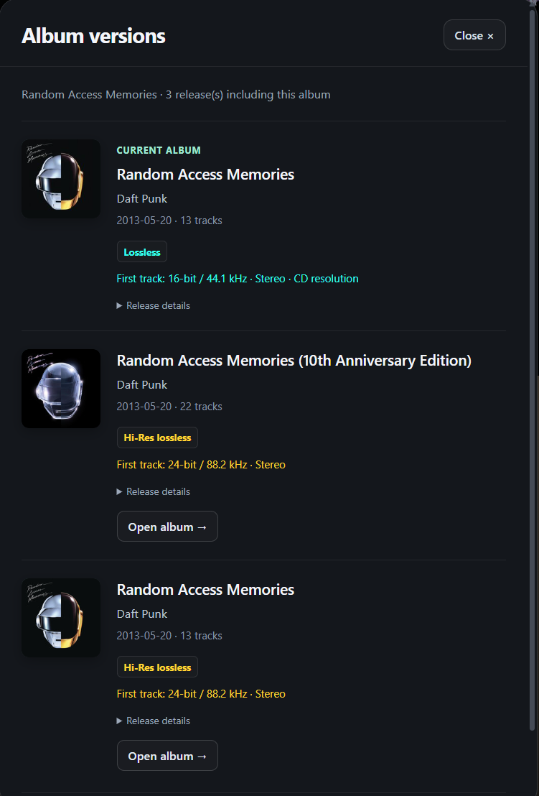

# Album Editions

A [TidaLuna](https://github.com/Inrixia/TidaLuna) plugin that brings related album editions into one view, including releases missing from native Other Versions links.

Based on the official [Luna template](https://github.com/Inrixia/luna-template).

## Why I made this

After seeing discussions on Reddit about album versions missing from TIDAL's version lists, I wanted an easier way to find related releases. Album Editions is inspired by Roon's album version browser and combines several TIDAL sources in one place.

## Screenshots

The Dark Side of the Moon: compare the original release, anniversary remaster and an Atmos edition.



Random Access Memories: compare the standard and anniversary editions, track counts and first track specifications.



Screenshots show results from the author's account. Availability can vary, and specifications apply to the first track rather than every track on the album.

## Installation

1. Open **Luna Settings** in TIDAL.
2. Add the following URL as a custom plugin store:

   https://github.com/pimull/tidaluna-album-editions/releases/latest/download/store.json

3. Find **Album Editions** (`album-editions`) in the plugin store and install it.
4. Enable the plugin, open an album page, and click **Versions**.

TidaLuna must be installed first. Album Editions is currently distributed through this custom store.

## Use

Open an album in TIDAL and click **Versions**. Results combine Other Versions, search and artist albums, deduplicate by album ID, and follow native links from matched editions. **Open album** navigates inside TIDAL without starting playback.

Stereo cards automatically read the first track's bit depth and sample rate. Lossless is cyan, Hi-Res yellow and Atmos blue. CD resolution requires exactly 16-bit/44.1 kHz. These values describe the returned first-track stream; other tracks may differ. Spatial cards retain their format label without probing a stereo fallback.

Expand **Release details** for sources, IDs and matching reasons, or **About these results** for discovery information. Incomplete sources remain visibly flagged. Close with Close, Escape or an outside click.

## Development

```sh
pnpm install --frozen-lockfile
pnpm run build
pnpm test
pnpm run serve
```

Use the Luna DEV store on port 3000. Reload after building. Source remains in `plugins/Example` from the template.

## Limits

Internal TIDAL endpoints may change. Heuristic matches require a shared artist ID and conservative title normalization; native associations are preserved. Matching does not prove identical audio or complete coverage.

Limits: 250 items per search/artist source, three artists, 12 additional related pages, 30 alternative details and 30 automatic specification probes (two concurrently). No MQA identification or Atmos filters are implemented.

Authentication stays in memory and is not logged or exported. The plugin does not alter collections, start playback or download audio. Repository-wide TypeScript checking reported errors during development and has not yet been confirmed clean.
